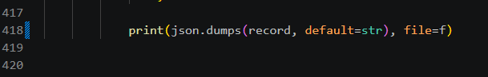
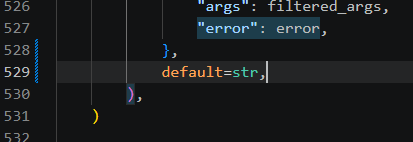

# TorchBench模型编译测试使用文档

**用途:** 说明如何在 `pytorch` 仓库里,用 TorchBench、HuggingFace、timm 三套模型,测试 TorchInductor\(`torch.compile` 的默认编译器\)的**编译精度**和**性能**\(相比 eager 的加速比\),并可同时抓取 profile。

**核心命令:** 在 `pytorch` 仓库根目录运行

```Plaintext
python benchmarks/dynamo/<入口>.py <测什么> <推理或训练> <精度> <后端> --output-directory <绝对路径> --output <文件名>.csv
```

三个入口 `torchbench.py`、`huggingface.py`、`timm_models.py` 的参数完全相同,只是测的模型不同。

---

## 1\. 环境准备

### 1\.1 目录与依赖

```Plaintext
$ROOT/
├── pytorch/        # 在这里运行所有命令; 测试脚本在 benchmarks/dynamo/
└── benchmark/   # 仅 torchbench.py 需要; 目录名必须是 benchmark
```

|入口|额外需要|
|---|---|
|三个都要|`pytorch` 仓库、`pandas`|
|`torchbench.py`|`benchmark` 仓库,并运行 `install.py`|
|`huggingface.py`|`transformers`、能访问 HuggingFace 镜像|
|`timm_models.py`|`timm`、能下载预训练权重|

`torchbench.py` 启动时从**当前目录**出发,依次找 `./torchbenchmark`、`../torchbenchmark`、`../torchbench`、`../benchmark` 来定位模型,所以必须在 `pytorch` 根目录运行,且 `benchmark` 与 `pytorch` 同级。

### 1\.2 安装

```Bash
mkdir -p $ROOT && cd $ROOT
git clone <pytorch 仓库地址> pytorch
git clone <benchmark 仓库地址> benchmark

pip install hf_transfer pandas "transformers==4.57.3" "timm==1.0.19" "huggingface-hub>=0.34.0,<1.0" "setuptools<81"
```

- **不要加 ****`-U`****\(升级\)。** `-U` 会装上 `transformers 5.x` 和 `huggingface_hub 2.x`,导致 `import transformers` 失败。

安装 TorchBench 各模型的依赖\(仅 `torchbench.py` 需要\):

```Bash
cd $ROOT/benchmark
python3 install.py phlippe_resnet -v                                # 单个模型
python3 install.py --continue_on_fail -v 2>&1 | tee install.log     # 全部模型, 失败的跳过
```

全量安装是逐个串行的,耗时长;detectron2 系列最容易失败,可用 `--skip 模型名` 跳过。

### 1\.3 自检

```Bash
cd /tmp
python3 -c "
import huggingface_hub, transformers, timm, timm.models._hub as h
print('hub', huggingface_hub.__version__, '| transformers', transformers.__version__, '| timm', timm.__version__, '| timm识别hub', h._has_hf_hub)" 2>&1 | tail -n 1
curl -s -o /dev/null -w "%{http_code}\n" -m 15 https://hf-mirror.com
```

期望:hub 版本在 0\.34 到 1\.0 之间,"timm识别hub"为 `True`;`curl` 返回 `200`。

---

## 2\. 快速上手

前提:已装好与硬件匹配的 `torch`、`torchvision`、`numpy`;已有 `pytorch` 和 `benchmark` 两个仓库,并按第 1 章装好依赖。

```Bash
# 第 1 步: 设置变量(每个新终端都要执行)
export ROOT=/workspace          # pytorch 和 benchmark 的父目录
export OUT=$ROOT/pytorch/benchmark_logs             # 结果目录, 必须是绝对路径
export HF_ENDPOINT=https://hf-mirror.com         # HuggingFace 国内镜像
mkdir -p $OUT/traces
export BASE="--inference --bfloat16 --backend inductor --disable-cudagraphs --device cuda --output-directory $OUT"

# 第 2 步: 进入 pytorch 根目录, 试跑精度(编译结果与 eager 是否一致)
cd $ROOT/pytorch
python benchmarks/dynamo/torchbench.py --accuracy $BASE --only phlippe_resnet --output quick_acc.csv

# 第 3 步: 试跑性能, 同时抓 profile
python benchmarks/dynamo/torchbench.py --performance --cold-start-latency $BASE --only phlippe_resnet \
    --export-profiler-trace --profiler-trace-name $OUT/traces/tb --output quick_perf.csv

# 第 4 步: 看结果
cat $OUT/quick_acc.csv $OUT/quick_perf.csv
```

**怎么读结果**:

- `quick_acc.csv` 的 `accuracy` 列为 `pass` 表示精度通过。

- `quick_perf.csv` 的 `speedup` 列:**大于 1 表示编译更快,小于 1 表示编译反而更慢**。

**第 5 步:查看 profile 文件。** 它在 `$OUT/traces/` 下:

```Bash
ls $OUT/traces/
```

用浏览器打开 https://ui\.perfetto\.dev 并拖入该文件即可查看\(文件在本地解析,不会上传\)。

跑通后,**去掉 ****`--only phlippe_resnet`**** 就是测该入口的全部模型。**

---

## 3\. 命令怎么写

本章帮你读懂第 2 章的命令。

### 3\.1 命令组成

```Bash
export BASE="--inference --bfloat16 --backend inductor --disable-cudagraphs --device cuda --output-directory $OUT"

python benchmarks/dynamo/torchbench.py --performance --cold-start-latency $BASE --only phlippe_resnet \
    --export-profiler-trace --profiler-trace-name $OUT/traces/tb --output quick_perf.csv
```

以第 2 章的性能测试命令为例,它由 8 个部分组成:

|**部分**|**写法**|**说明**|
|---|---|---|
|① 入口|`torchbench.py`|测哪一套模型\(三选一,见第 4\.1 节\)|
|② 测什么|`--performance`|`--performance`测性能:eager 与编译版交替计时,得到 `speedup`\(快多少\)。<br>换成 `--accuracy` 测精度:编译版输出与 eager 是否一致,得到 `pass` 或失败原因。**建议先测精度,通过后再测性能**|
|③ 推理还是训练|`--inference`|只做前向计算。`--training` 还包含反向传播和参数更新,更慢、更占显存|
|④ 编译后端|`--backend inductor`|用哪个编译器|
|⑤ 精度|`--bfloat16`|数据的存储格式,`--bfloat16` / `--float16` / `--float32` / `--amp`<br>精度,四选一;`--amp` 是自动混合精度,常用于训练<br>不写使用模型自带的格式\(一般是 float32\)|
|⑥ 设备|`--device cuda`|DCU/ROCm 环境同样写 `cuda`|
|⑦ 选模型|`--only phlippe_resnet`|只测一个模型;不写就测该入口的全部模型|
|⑧ 输出|`--output-directory $OUT --output quick_perf.csv`|结果存放的目录和文件名|

第 2 章里的 `$BASE` 只是把 ③④⑤⑥、`--disable-cudagraphs` 和 `--output-directory $OUT` 打包成一个变量,省得每条命令重复写;`--output` 文件名仍要每条命令单独写。

### 3\.2 常用参数选项

|**想做什么**|**选项**|**说明**|
|---|---|---|
|排除某个模型|`--exclude-exact 模型名`|全量测试时使用,可重复写|
|多卡并行|`--total-partitions N --partition-id i`|把全部模型平均分成 N 份,本次只跑第 i 份\(i 从 0 开始\)<br>|
|改批量|`--batch-size N`|覆盖模型默认的批量\(batch size,一次处理多少条数据\)|
|把编译耗时测进去|`--cold-start-latency`|清空编译缓存再运行,`compilation_latency` 才有意义;不写则可能复用上次缓存。已设置环境变量 `TORCHINDUCTOR_CACHE_DIR` 时不会清缓存|
|关闭 CUDA Graph|`--disable-cudagraphs`<br>|CUDA Graph 是把一连串 GPU 调用录下来、之后一次回放,省去逐个启动的开销,默认开启。|
|测几轮|`--repeat N`|每个模型计时多少组,默认 30。调小出结果快,但数据更不稳定|
|确认是否整图编译|`--nopython`|遇到 graph break 就报错。graph break\(图断开\)指编译器遇到不支持的写法,断开计算图、该处退回 eager 执行;默认允许断开|
|看清断在哪|`--print-graph-breaks`|图断开时打印警告|
|改超时|`--timeout 秒`|单个模型的最长运行时间,默认 2000 秒,超时算失败|
|保留旧结果|`--retain-output`|默认每次启动会先删掉同名的旧 CSV 再重新生成;加上它则追加到旧文件后面|

完整列表:`python benchmarks/dynamo/torchbench.py --help`

### 3\.3 编译模式参数

|**想要的模式**|**作用**|**怎么写**|
|---|---|---|
|default<br>|不开 CUDA Graph<br>|`--backend inductor --disable-cudagraphs`<br>|
|reduce\-overhead|开启 CUDA Graph,省启动开销<br>|`--backend inductor`,不写 `--disable-cudagraphs`|
|max\-autotune|对算子多试几种实现、挑最快的,编译时间长很多|命令前加 `TORCHINDUCTOR_MAX_AUTOTUNE=1`|
|freezing|把权重当常量,允许更激进的优化;会额外跳过一批已知不支持的模型|加 `--freezing`<br>|
|动态形状|输入尺寸变化时不重新编译|加 `--dynamic-shapes --dynamic-batch-only`|
|AOT Inductor|提前把模型编译成独立库再加载;**只支持推理**,且要求能完整捕获成一张图|用 `--export-aot-inductor` 代替 `--backend inductor`,不要两个都写|

---

## 4\. 使用场景

假设已执行第 2 章的第 1 步的变量（如下）,并在 `pytorch` 根目录。

```Bash
# 第 1 步: 设置变量(每个新终端都要执行)
export ROOT=/workspace          # pytorch 和 benchmark 的父目录
export OUT=$ROOT/pytorch/benchmark_logs             # 结果目录, 必须是绝对路径
export HF_ENDPOINT=https://hf-mirror.com         # HuggingFace 国内镜像
mkdir -p $OUT/traces
export BASE="--inference --bfloat16 --backend inductor --disable-cudagraphs --device cuda --output-directory $OUT"
```

示例模型:`phlippe_resnet`\(torchbench\)、`AlbertForMaskedLM`\(huggingface\)、`adv_inception_v3`\(timm\)。**去掉 ****`--only ...`**** 就是测该入口的全部模型。**

### 4\.1 三个入口

|入口|模型来源|模型名单|
|---|---|---|
|`torchbench.py`|`benchmark` 仓库的 TorchBench 模型|`benchmark/torchbenchmark/models/` 下的目录名，105个<br>|
|`huggingface.py`<br>|`transformers` 库<br>|`pytorch/benchmarks/dynamo/huggingface_models_list.txt`39个<br>|
|`timm_models.py`|`timm` 库|`pytorch/benchmarks/dynamo/timm_models_list.txt`，18个|

注意:TorchBench 的模型名是**目录名。**

三个入口共用同一套测试流程和命令参数,（共用同一个测试框架**，**都调用 `common.py` 里的主流程）。只是测的模型来源不同。

### 4\.2 测精度

\(建议先于性能\)

```Bash
python benchmarks/dynamo/torchbench.py  --accuracy $BASE --only phlippe_resnet    --output tb_acc.csv
python benchmarks/dynamo/huggingface.py --accuracy $BASE --only AlbertForMaskedLM --output hf_acc.csv
python benchmarks/dynamo/timm_models.py --accuracy $BASE --only adv_inception_v3  --output timm_acc.csv
```

`--accuracy` 与 `--performance` 互斥,必须分成两条命令。

### 4\.3 测性能

```Bash
python benchmarks/dynamo/torchbench.py  --performance --cold-start-latency $BASE --only phlippe_resnet    --output tb.csv
python benchmarks/dynamo/huggingface.py --performance --cold-start-latency $BASE --only AlbertForMaskedLM --output hf.csv
python benchmarks/dynamo/timm_models.py --performance --cold-start-latency $BASE --only adv_inception_v3  --output timm.csv
```

不需要另跑 eager:一条命令里 eager 与 compile 交替各计时 30 组,`speedup` 就是对比结果。

### 4\.4 测性能并抓 profile

在第 4\.3 节的命令后追加 `--export-profiler-trace --profiler-trace-name $OUT/traces/前缀`,三个入口用不同前缀:

```Bash
python benchmarks/dynamo/torchbench.py  --performance --cold-start-latency $BASE --only phlippe_resnet    --export-profiler-trace --profiler-trace-name $OUT/traces/tb   --output tb.csv
python benchmarks/dynamo/huggingface.py --performance --cold-start-latency $BASE --only AlbertForMaskedLM --export-profiler-trace --profiler-trace-name $OUT/traces/hf   --output hf.csv
python benchmarks/dynamo/timm_models.py --performance --cold-start-latency $BASE --only adv_inception_v3  --export-profiler-trace --profiler-trace-name $OUT/traces/timm --output timm.csv
```

一条命令同时得到 CSV 和 trace。详见第 5\.3 节。

### 4\.5 测全部模型性能

```Bash
python benchmarks/dynamo/torchbench.py  --performance --cold-start-latency $BASE --output tb.csv   2>&1 | tee $OUT/tb.log
python benchmarks/dynamo/huggingface.py --performance --cold-start-latency $BASE --output hf.csv   2>&1 | tee $OUT/hf.log
python benchmarks/dynamo/timm_models.py --performance --cold-start-latency $BASE --output timm.csv 2>&1 | tee $OUT/timm.log
```

- 全量运行时,每个模型是一个独立子进程,某个模型出错不影响其他模型。

- 三个入口互相独立,可以放在不同的卡上同时跑。

---

## 5\. 看结果

### 5\.1 CSV 关键列

|列|含义|
|---|---|
|`speedup`|eager 耗时 ÷ compile 耗时。大于 1 编译更快,小于 1 更慢|
|`abs_latency`|编译路径的耗时\(毫秒\)|
|`compilation_latency`|编译耗时\(秒\)|
|`graph_breaks`|图断开次数|

同目录还会生成 `*_compilation_metrics.csv`\(各编译阶段耗时\)和 `.json`,可忽略。

**为什么有些模型不在 CSV 里?** 模型加载或运行出错时不会写任何行,只有超时才会写一行 `speedup=0.0`。所以"不在 CSV 里"和"`speedup` 为 0"都表示失败或被跳过,去对应 `.log` 里搜 `Run failed with return code` 查原因。

### 5\.2 profile 文件

```Plain Text
--export-profiler-trace --profiler-trace-name $OUT/traces/前缀
```

- **位置由 ****`--profiler-trace-name`**** 决定。** 写成"绝对目录 \+ 前缀"\(如 `$OUT/traces/tb`\),文件就直接生成在那个目录。

- **文件名:** `<前缀>_<模型名>_rank_0.json`,例如 `$OUT/traces/tb_phlippe_resnet_rank_0.json`。

- **内容:** 同一个文件里有两段,`expected` 是 eager,`actual` 是 compile。

- **两个注意:** 目录必须提前创建\(`mkdir -p $OUT/traces`\),否则导出时报找不到目录;必须写绝对路径。

- 如果只写 `--profiler-trace-name tb`\(不带目录\),文件会被写到 Python 安装目录 `torch._dynamo.config.base_dir`\(本机是 `/usr/local/lib/python3.12/site-packages/`\),它不跟随 `--output-directory`,需要自己 `mv` 出来。

**查看:** 打开 https://ui\.perfetto\.dev 拖入文件,搜索 `expected` 或 `actual` 跳到对应段,框选后下方表格按耗时排序。重点看两点:GPU 行有没有大段空白\(说明瓶颈在 CPU 调度\);`triton_..._fused_...` 融合算子的数量\(越多说明融合越充分\)。

### 5\.3 抓 profile 会影响耗时吗

- **CSV 里的数字不受影响。** 程序先正常计时,最后才单独再跑一轮开 profiler。

- **整条命令会变长**,每个模型多跑一轮;这一轮不重新编译。

- trace 里的毫秒数带 profiler 开销,不要与 CSV 的 `abs_latency` 直接比,只看 eager 与 compile 的相对差异。

- `--profile-details` 可选:额外记录输入形状、内存、调用栈,文件会明显变大。建议全量不加,对有问题的模型再单独加。

#### **修复 ****`--profile-details`**** 报错**

报错信息：

```Python

**  File "/workspace/pytorch/benchmarks/dynamo/common.py**", line 418, in output_json
    print(json.dumps(record), file=f)
          ^^^^^^^^^^^^^^^^^^
  File "/usr/local/lib/python3.12/json/__init__.py", line 231, in dumps
    return _default_encoder.encode(obj)
           ^^^^^^^^^^^^^^^^^^^^^^^^^^^^
  File "/usr/local/lib/python3.12/json/encoder.py", line 200, in encode
    chunks = self.iterencode(o, _one_shot=True)
             ^^^^^^^^^^^^^^^^^^^^^^^^^^^^^^^^^^
  File "/usr/local/lib/python3.12/json/encoder.py", line 258, in iterencode
    return _iterencode(o, 0)
           ^^^^^^^^^^^^^^^^^
  File "/usr/local/lib/python3.12/json/encoder.py", line 180, in default
    raise TypeError(f'Object of type {o.__class__.__name__} '
TypeError: Object of type ProfilerActivity is not JSON serializable
```

**`原因： `**具体错误是:`args.profile_details` 里的 `activities` 列表装着 `ProfilerActivity` 枚举对象,Python 的 `json` 不认识它,所以写结果文件时抛出 `TypeError: Object of type ProfilerActivity is not JSON serializable`。

**修改：**在需要 `--profile-details` 时才改。**先备份,再改 ****`pytorch/benchmarks/dynamo/common.py`**,共两处,都是给 `json.dumps` 加 `default=str`\(遇到无法序列化的对象时转成字符串\):

|位置|原来|改成|
|---|---|---|
|`output_json` 函数里|`print(json.dumps(record), file=f)`|`print(json.dumps(record, default=str), file=f)`|
|`output_signpost` 函数里 `json.dumps({ ... })` 的末尾|`"error": error,` 之后紧接 `}` 和 `),`|在 `}` 后补 `,` 并新增一行 `default=str,`<br>|





只改一处会在另一处继续报同样的错。改好后可用下面命令确认出现 2 行:

```Bash
cd $ROOT/pytorch/benchmarks/dynamo && cp common.py common.py.bak    # 先备份
grep -n "default=str" common.py
```

这两处修改已在隔离目录里用 `phlippe_resnet` 加 `--profile-details --export-profiler-trace` 完整重跑验证:命令退出码 0,CSV、json、compilation\_metrics、trace 均生成。


---

## 6\. 一键脚本

三个入口全量跑性能加 profile,存为 `run.sh`,用 `bash run.sh` 运行。

```Bash
#!/bin/bash
ROOT=/workspace
OUT=$ROOT/pytorch/benchmark_logs
export HF_ENDPOINT=https://hf-mirror.com
mkdir -p $OUT/traces

# 必须在 pytorch 根目录之外执行
(cd /tmp && python3 -c "import timm.models._hub as h,sys; sys.exit(0 if h._has_hf_hub else 1)" >/dev/null 2>&1) \
  || { echo "timm 无法识别 huggingface-hub, 请按文档第 1.2、1.3 节检查版本"; exit 1; }

cd $ROOT/pytorch || exit 1
COMMON="--performance --cold-start-latency --inference --bfloat16 --backend inductor \
--disable-cudagraphs --device cuda --export-profiler-trace --output-directory $OUT"

python benchmarks/dynamo/torchbench.py  $COMMON --profiler-trace-name $OUT/traces/tb   --output tb.csv   2>&1 | tee $OUT/tb.log
python benchmarks/dynamo/huggingface.py $COMMON --profiler-trace-name $OUT/traces/hf   --output hf.csv   2>&1 | tee $OUT/hf.log
python benchmarks/dynamo/timm_models.py $COMMON --profiler-trace-name $OUT/traces/timm --output timm.csv 2>&1 | tee $OUT/timm.log

echo "完成: CSV 在 $OUT, trace 在 $OUT/traces"
```

脚本每次启动会自动删除同名的旧 CSV 再重建。自检部分已在本机执行通过;脚本中的 `--profiler-trace-name` 绝对路径写法已用 `phlippe_resnet` 单模型验证;完整脚本没有整体重跑。

## **7\.** **模型清单**

三个入口的模型名已经统计好,放在下面一张表里。

|序号|torchbench\.py\(候选 105 / 实际 72\)|huggingface\.py\(候选 40 / 实际 31\)|timm\_models\.py\(候选 18 / 实际 18\)|
|---|---|---|---|
|1|`BERT_pytorch`|`AlbertForMaskedLM`|`adv_inception_v3`|
|2|`Background_Matting`|`AllenaiLongformerBase`|`beit_base_patch16_224`|
|3|`LearningToPaint`|`BartForCausalLM`|`convnextv2_nano.fcmae_ft_in22k_in1k`|
|4|`Super_SloMo`|`BertForMaskedLM`|`deit_base_distilled_patch16_224`|
|5|`alexnet`|`BlenderbotForCausalLM`|`deit_tiny_patch16_224.fb_in1k`|
|6|`basic_gnn_edgecnn`|`BlenderbotForConditionalGeneration`\\\*|`dm_nfnet_f0`|
|7|`basic_gnn_gcn`|`DebertaV2ForMaskedLM`|`ghostnet_100`|
|8|`basic_gnn_gin`|`DistilBertForMaskedLM`|`inception_v3`|
|9|`basic_gnn_sage`|`DistillGPT2`|`mobilenetv2_100`|
|10|`cm3leon_generate`|`ElectraForCausalLM`|`mobilenetv3_large_100`|
|11|`dcgan`|`GPT2ForSequenceClassification`|`mobilevit_s`|
|12|`demucs`|`GPTJForCausalLM`\\\*|`nfnet_l0`|
|13|`densenet121`|`GPTJForQuestionAnswering`\\\*|`repvgg_a2`|
|14|`detectron2_fasterrcnn_r_101_c4`|`GPTNeoForCausalLM`\\\*|`swin_base_patch4_window7_224`|
|15|`detectron2_fasterrcnn_r_101_dc5`|`GPTNeoForSequenceClassification`\\\*|`tf_efficientnet_b0`|
|16|`detectron2_fasterrcnn_r_101_fpn`|`GoogleFnet`|`visformer_small`|
|17|`detectron2_fasterrcnn_r_50_c4`|`LayoutLMForMaskedLM`|`vit_base_patch14_dinov2.lvd142m`|
|18|`detectron2_fasterrcnn_r_50_dc5`|`M2M100ForConditionalGeneration`|`vit_base_patch16_siglip_256`|
|19|`detectron2_fasterrcnn_r_50_fpn`|`MBartForCausalLM`||
|20|`detectron2_fcos_r_50_fpn`|`MT5ForConditionalGeneration`||
|21|`detectron2_maskrcnn`\\\*|`MegatronBertForCausalLM`||
|22|`detectron2_maskrcnn_r_101_c4`|`MobileBertForMaskedLM`||
|23|`detectron2_maskrcnn_r_101_fpn`|`OPTForCausalLM`||
|24|`detectron2_maskrcnn_r_50_c4`|`PLBartForCausalLM`||
|25|`detectron2_maskrcnn_r_50_fpn`|`PegasusForCausalLM`||
|26|`dlrm`|`Qwen/Qwen3-0.6B`||
|27|`doctr_det_predictor`|`Reformer`\\\*||
|28|`doctr_reco_predictor`|`RobertaForCausalLM`||
|29|`drq`|`T5ForConditionalGeneration`||
|30|`fastNLP_Bert`|`T5Small`||
|31|`functorch_dp_cifar10`|`TrOCRForCausalLM`||
|32|`functorch_maml_omniglot`|`XGLMForCausalLM`||
|33|`hf_Albert`\\\*|`XLNetLMHeadModel`||
|34|`hf_Bart`\\\*|`YituTechConvBert`||
|35|`hf_Bert`\\\*|`google/gemma-2-2b`||
|36|`hf_Bert_large`\\\*|`google/gemma-3-4b-it`\\\*||
|37|`hf_BigBird`\\\*|`meta-llama/Llama-3.2-1B`||
|38|`hf_DistilBert`\\\*|`mistralai/Mistral-7B-Instruct-v0.3`\\\*||
|39|`hf_GPT2`\\\*|`openai/gpt-oss-20b`\\\*||
|40|`hf_GPT2_large`\\\*|`openai/whisper-tiny`||
|41|`hf_Longformer`\\\*|||
|42|`hf_Reformer`\\\*|||
|43|`hf_Roberta_base`\\\*|||
|44|`hf_T5`\\\*|||
|45|`hf_T5_base`\\\*|||
|46|`hf_T5_generate`\\\*|||
|47|`hf_T5_large`\\\*|||
|48|`hf_Whisper`\\\*|||
|49|`hf_clip`\\\*|||
|50|`hf_distil_whisper`\\\*|||
|51|`lennard_jones`|||
|52|`llama`|||
|53|`llama_v2_7b_16h`|||
|54|`llava`|||
|55|`maml`|||
|56|`maml_omniglot`|||
|57|`microbench_unbacked_tolist_sum`|||
|58|`mnasnet1_0`|||
|59|`mobilenet_v2`|||
|60|`mobilenet_v2_quantized_qat`|||
|61|`mobilenet_v3_large`|||
|62|`moco`|||
|63|`modded_nanogpt`\\\*|||
|64|`moondream`|||
|65|`nanogpt`|||
|66|`nvidia_deeprecommender`|||
|67|`opacus_cifar10`|||
|68|`phlippe_densenet`|||
|69|`phlippe_resnet`|||
|70|`pyhpc_equation_of_state`|||
|71|`pyhpc_isoneutral_mixing`|||
|72|`pyhpc_turbulent_kinetic_energy`|||
|73|`pytorch_CycleGAN_and_pix2pix`\\\*|||
|74|`pytorch_stargan`|||
|75|`pytorch_unet`|||
|76|`resnet152`|||
|77|`resnet18`|||
|78|`resnet50`|||
|79|`resnet50_quantized_qat`|||
|80|`resnext50_32x4d`|||
|81|`sam`|||
|82|`sam_fast`|||
|83|`shufflenet_v2_x1_0`|||
|84|`simple_gpt`|||
|85|`simple_gpt_tp_manual`\\\*|||
|86|`soft_actor_critic`|||
|87|`speech_transformer`|||
|88|`squeezenet1_1`|||
|89|`stable_diffusion_text_encoder`\\\*|||
|90|`stable_diffusion_unet`\\\*|||
|91|`tacotron2`\\\*|||
|92|`timm_efficientdet`\\\*|||
|93|`timm_efficientnet`\\\*|||
|94|`timm_nfnet`\\\*|||
|95|`timm_regnet`\\\*|||
|96|`timm_resnest`\\\*|||
|97|`timm_vision_transformer`\\\*|||
|98|`timm_vision_transformer_large`\\\*|||
|99|`timm_vovnet`\\\*|||
|100|`torch_multimodal_clip`|||
|101|`torchrec_dlrm`|||
|102|`tts_angular`|||
|103|`vgg16`|||
|104|`vision_maskrcnn`|||
|105|`yolov3`|||

带 `*` 的是默认跳过的模型。全量运行时不会测,但可以用 `--only` 单独指定。
